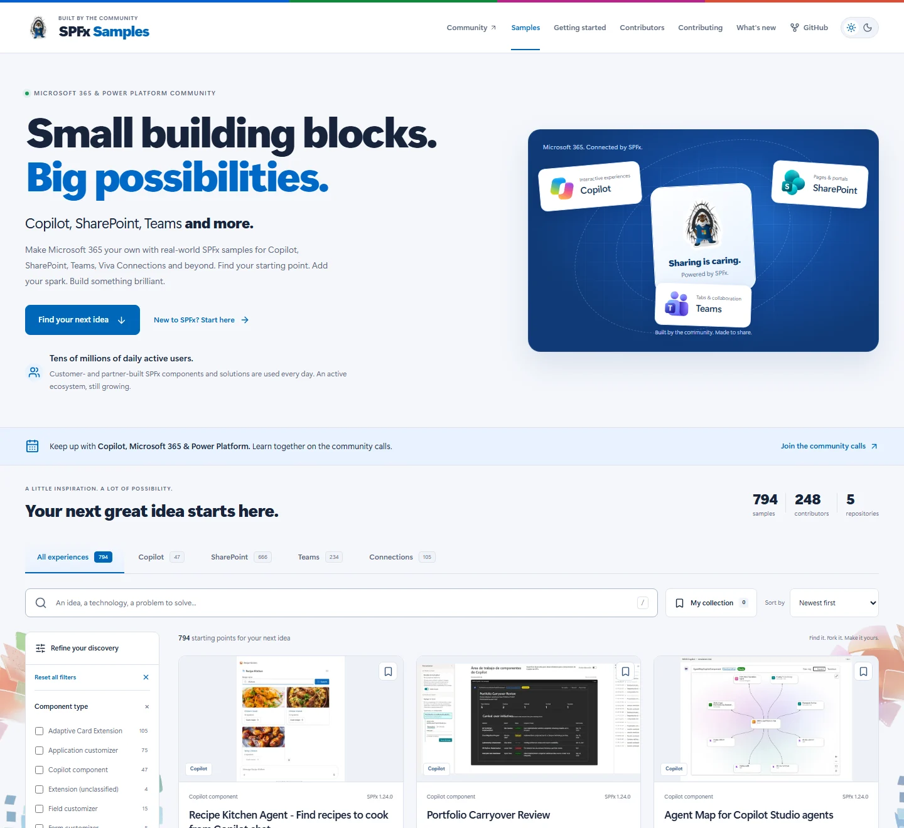

# Contributing to SPFx Samples

**Sharing is caring.** Useful code, clear explanations and practical demos help
other people build better Microsoft 365 experiences. Everyone is welcome.

[](https://pnp.github.io/spfx/)

**[Explore the live gallery](https://pnp.github.io/spfx/)**

## Choose the right place

This repository builds the central gallery. Sample code, setup instructions and
sample metadata belong in their original repositories:

| Your contribution               | Repository                                                                      |
| ------------------------------- | ------------------------------------------------------------------------------- |
| Web parts and page experiences  | [pnp/sp-dev-fx-webparts](https://github.com/pnp/sp-dev-fx-webparts)             |
| Extensions and form customizers | [pnp/sp-dev-fx-extensions](https://github.com/pnp/sp-dev-fx-extensions)         |
| Copilot components              | [pnp/spfx-copilot-components](https://github.com/pnp/spfx-copilot-components)   |
| Connected reference solutions   | [pnp/spfx-reference-scenarios](https://github.com/pnp/spfx-reference-scenarios) |
| Adaptive Card Extensions        | [pnp/sp-dev-fx-aces](https://github.com/pnp/sp-dev-fx-aces)                     |

Follow the contribution guidance in the relevant source repository. Use its
actual package dependencies, README, authorship and existing media to validate
metadata. Do not copy sample projects into this central repository.

For gallery design, search, filters, accessibility, catalog processing or
documentation improvements, open an issue or pull request **here**.

## Share a demo and join the calls

- [Join the Copilot, Microsoft 365 and Power Platform community calls](https://aka.ms/community/calls)
  to learn from current scenarios and keep up to date.
- [Fill in the community demo request form](https://aka.ms/community/request/demo)
  when you have something useful to show. Tell us about your idea and availability;
  the team will work with you to schedule a suitable slot.
- New to open source? The [Sharing is Caring program](https://pnp.github.io/sharing-is-caring/)
  can help you get started with GitHub and community contributions.

## Community contributor recognition

[](https://pnp.github.io/recognitionprogram/)

Sample contributors can opt in to the
[PnP Recognition Program](https://pnp.github.io/recognitionprogram/). Read its
current recognition process and eligibility guidance. This gallery does not
issue badges or automatically enroll people.

## Work on the gallery

Use Node.js 22.23.4+ and npm 11. From a clean checkout:

```powershell
npm exec --yes --package=npm@11.21.1 -- npm ci
npm run samples:refresh
npm test
npm run check
npm run build
npx playwright install chromium
npm run test:e2e
```

`npm run dev` starts the local site at `http://localhost:4321/spfx/`.
`npm test` prepares its generated catalog inputs before running the tests.
The first catalog generation prepares primary image previews; later runs use
the local cache. No source sample project is installed or executed.

Before submitting a pull request:

- Keep changes focused and explain the intended behavior.
- Include desktop/mobile screenshots for visual changes, including dark mode.
- Preserve keyboard navigation, accessible labels, contrast and reduced motion.
- Update the README preview when the visible experience materially changes.
- Keep generated snapshots, catalog JSON, preview caches and build output out
  of commits; [the ignore rules](./.gitignore) identify them.
- Follow the existing TypeScript guards and shared helpers instead of hiding
  malformed source data with silent defaults.

## Catalog and presentation rules

- [The source registry](./.metadata/sources.json) is authoritative for collection.
  Read original metadata, not already merged feeds that would duplicate samples.
- All catalog counts come from refreshed data. Do not hardcode sample,
  contributor, source or filter totals in page copy.
- Preserve original attribution, source links and known metadata issues.
  Missing previews get a labeled fallback, not an invented screenshot.
- Do not expand [the quality baseline](./.metadata/quality-baseline.json) simply
  to make CI green. Existing findings stay visible; new errors block publishing.
- Use the supplied official logos and Parker artwork with their original
  proportions. Keep the Connections filter and relevant text, but do not
  reintroduce a Connections promotional logo.
- Branding and decorative assets have documented provenance in the
  [asset notice](./public/asset-license.txt). Do not redraw product marks or
  add unlicensed assets.
- The SPFx ecosystem-scale statement is editorial context supplied by the
  maintainers. Do not turn it into fabricated telemetry, a live counter or
  an unsupported growth percentage.

## Publishing

Pull requests validate without deploying. Approved changes on `main` publish
only after the [gallery workflow](./.github/workflows/refresh-metadata.yml) passes.
Source data is also refreshed daily at 04:17 UTC, or manually with **Actions ->
Refresh and publish gallery -> Run workflow**. Scheduling is best-effort.

Please also follow the [Microsoft Open Source Code of Conduct](https://opensource.microsoft.com/codeofconduct/).
