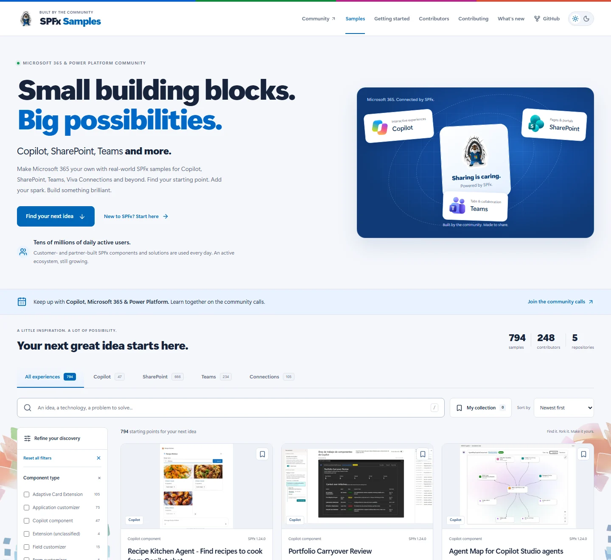

# SPFx Samples

**Copilot, SharePoint, Teams and more.** A community-built Microsoft 365 sample
gallery, powered by SPFx, with a distinctive Parker/blue identity and shared
Microsoft 365 & Power Platform Community navigation.

**[Open the live gallery](https://pnp.github.io/spfx/)**

[](https://github.com/pnp/spfx/actions/workflows/refresh-metadata.yml)

[](https://pnp.github.io/spfx/)

The Astro gallery is published from `main` through GitHub Actions and GitHub
Pages. Use the gallery link above or the repository's About link to test it.
The screenshot is an illustration of the experience; open the site for current counts.

## Sharing is caring

This gallery is built by the community, for the community. Share useful code,
help someone get started, and bring what you learn back to others.

- **[Join the community calls](https://aka.ms/community/calls)** to keep up with
  Copilot, Microsoft 365 and Power Platform.
- **[Sign up to present a demo](https://aka.ms/community/request/demo)** if you
  have a pattern, solution or idea to show. Fill in the form and the team will
  arrange a slot based on your availability.
- **[Contribute a sample or improve the gallery](./CONTRIBUTING.md)**. Source
  samples stay in their original repositories; gallery improvements belong here.

[](https://pnp.github.io/recognitionprogram/)

Sample contributors can opt in to the
[PnP Recognition Program](https://pnp.github.io/recognitionprogram/) for community
contributor recognition. Badges are handled by that program, not awarded
automatically by this gallery.

## Run locally

Use **Node.js 22.23.4+** and **npm 11**. To use the supported npm without changing
a shared machine's global installation:

```powershell
npm exec --yes --package=npm@11.21.1 -- npm ci
npm run samples:refresh
npm run dev
```

Open **http://localhost:4321/spfx/**. The first generation prepares local screenshot
previews; later runs reuse the cache. Development and production builds do not
install or execute any source sample projects.

```powershell
npm test
npm run check
npm run build
npx playwright install chromium
npm run test:e2e
npm run preview -- --port 4321
```

Astro requires the stated Node version. TypeScript 6 is intentional: the current
Astro checker supports TypeScript 5/6, not TypeScript 7. npm 11 avoids the npm 10
peer-resolution failure encountered when installing the Astro toolchain.
Browser tests start a production preview on port 4321, or reuse an existing local
preview there; Astro permits only one preview process per project.
`npm test` first generates its public catalog inputs from the audited metadata,
so the same command works after a clean checkout and source refresh.

## The experience

- Microsoft 365-first, with official **Copilot, SharePoint and Teams**
  logos alongside Parker. **Connections remains a discovery tab and
  part of the text**, but no longer has a promotional hero logo.
- Search across sample text, technology, source and contributors.
- Combined component, technology, SPFx-version and source filters: OR within a
  group, AND between groups; dynamic counts and shareable URL state.
- Newest, updated and alphabetical sorting, pagination, reset and empty states.
- A browser-local saved collection, without accounts or analytics.
- Sample details, source-specific documentation/download/issue links,
  contributor recognition, getting started and What's new.
- Persistent light/dark themes, responsive navigation and a complete
  no-JavaScript [sample directory](./src/pages/browse.astro).

SharePoint remains an important, explicit part of the gallery. It is not the
exclusive portal brand, and original sample titles, screenshots and attribution
are not rewritten to hide their product context.

## Data flow and quality

The [source registry](./.metadata/sources.json) configures the five upstream
repositories. [Collection](./.github/scripts/collect-samples.mjs) pins each
revision and reads original metadata/package/component manifests. It does not
import merged feeds that would duplicate extensions.

| Information              | Authoritative source                                                            |
| ------------------------ | ------------------------------------------------------------------------------- |
| Web parts                | [pnp/sp-dev-fx-webparts](https://github.com/pnp/sp-dev-fx-webparts)             |
| Extensions               | [pnp/sp-dev-fx-extensions](https://github.com/pnp/sp-dev-fx-extensions)         |
| Copilot components       | [pnp/spfx-copilot-components](https://github.com/pnp/spfx-copilot-components)   |
| Reference scenarios      | [pnp/spfx-reference-scenarios](https://github.com/pnp/spfx-reference-scenarios) |
| Adaptive Card Extensions | [pnp/sp-dev-fx-aces](https://github.com/pnp/sp-dev-fx-aces)                     |

1. `npm run samples:refresh` updates local `.metadata/samples.json` and the audit.
2. `npm run catalog:generate` creates the typed public catalog, compact discovery
   index and cached primary screenshot previews.
3. Astro generates the gallery and every sample's static detail page.

Generated snapshots, public catalog files, previews and build output are ignored
by Git. The refresh workflow recreates them from source.

All displayed sample, contributor, repository and filter counts are computed
from the collected catalog during each refresh. No catalog totals are manually
maintained in page templates. The ecosystem statement about tens of millions
of daily active users is maintainer-approved context about customer- and
partner-built SPFx components and solutions, not a live gallery-traffic counter
or a number inferred from sample metadata.

Known source defects remain visible in sample details and
[catalog health](./src/pages/catalog-health.astro). Missing descriptions or
versions are not fabricated, and package mismatches are not silently advertised
as verified compatibility. Reviewed support folders stay inventoried without
becoming fake samples. The two verified Bot Framework ACEs keep their real
framework rather than an invented SPFx version.

Existing errors are recorded in the reviewed
[quality baseline](./.metadata/quality-baseline.json). Incomplete collection and
new errors fail explicitly. `npm run samples:baseline` is a deliberate review
operation, never an automatic CI repair. Source metadata quality is separate
from sample build/runtime validation.

Primary previews are resized to WebP, cached locally and accompanied by a public
processing/provenance report. Missing, oversized or undecodable images use the
clearly labeled [generic fallback](./assets/images/sample-preview-fallback.png).
Original media and author attribution stay in their source repositories.

## Publishing

The [gallery workflow](./.github/workflows/refresh-metadata.yml) runs daily at
**04:17 UTC**, manually, and on relevant central-repository changes:

**Collect -> audit -> unit tests -> type check -> build -> browser/accessibility
tests -> upload Pages artifact -> deploy.**

Pull requests validate but do not deploy. Only the separate `github-pages`
deployment job receives Pages/OIDC write permissions. A failed collection,
quality gate or build cannot replace the last successful deployment.

Pages is configured with **Source: GitHub Actions**, HTTPS and a `github-pages`
environment restricted to `main`. The [deployment workflow](https://github.com/pnp/spfx/actions/workflows/refresh-metadata.yml)
passed the Linux build, unit tests and browser checks. Desktop/mobile
checks were also run successfully against the public site, including discovery,
saved collections, themes, source actions, fallbacks and accessibility.

For an on-demand refresh, open **Actions -> Refresh and publish gallery -> Run
workflow** and select `main`. Daily refresh remains scheduled for 04:17 UTC;
GitHub schedules are best-effort.

## Tracking and credits

- [Implementation plan and acceptance criteria](./todo.md)
- [Source repairs, PRs and deferred preview backlog](./sample-tracking.md)
- [Current metadata quality report](./.metadata/quality-report.md)

Parker and the community fonts are shared with the Script Samples gallery.
The supplied official product logos and contributor badge are used without
redrawing their artwork. The abstract side backgrounds come from the
[Copilot UX components reference gallery](https://pnp.github.io/spfx-copilot-components/).
The [asset notice](./public/asset-license.txt) records provenance and preserves
the applicable MIT notices and separate branding rights. Screenshot rights
remain with their original sample owners. The gallery adds no visitor tracking.
